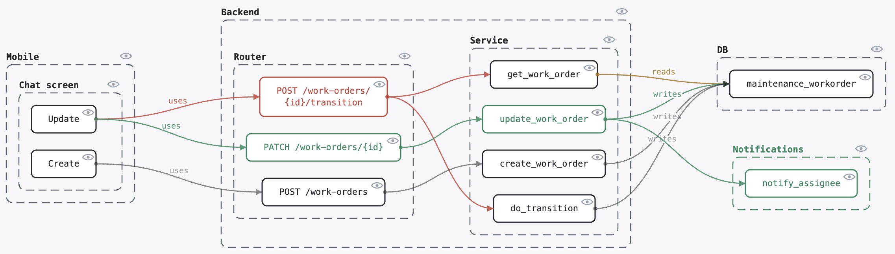
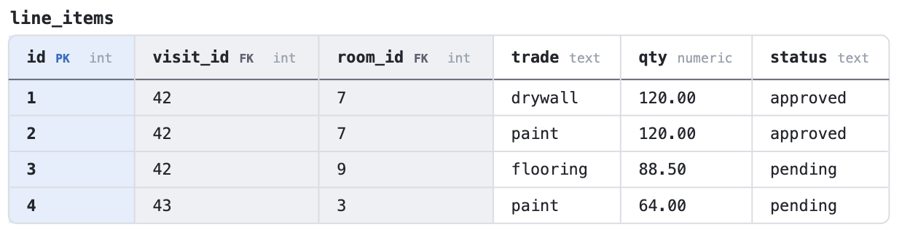
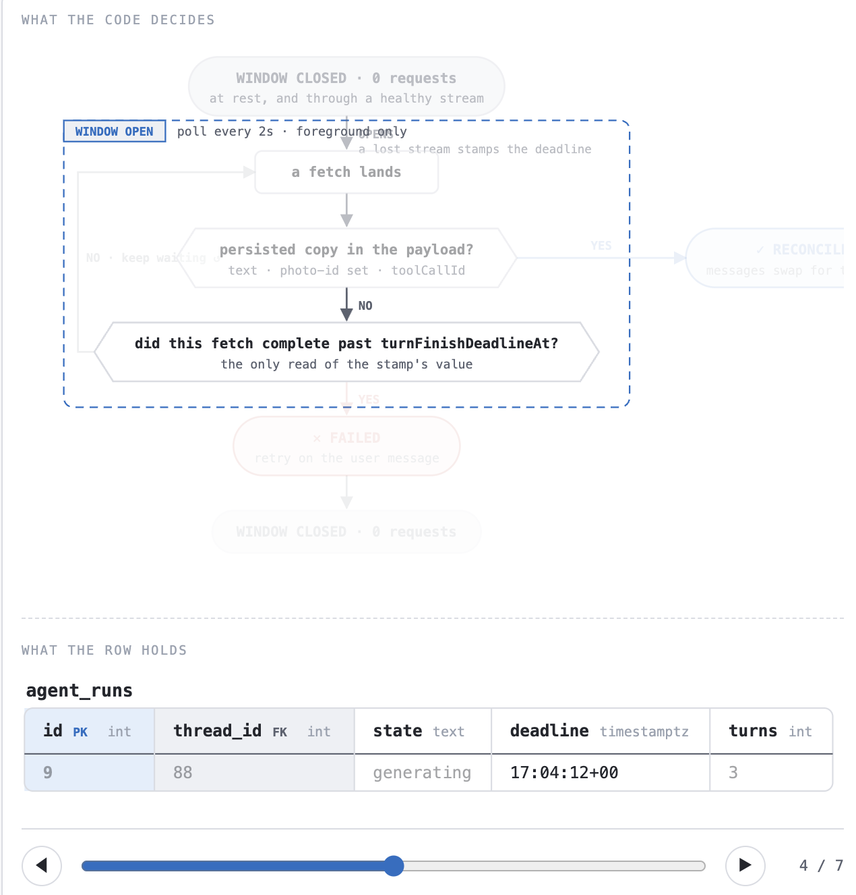
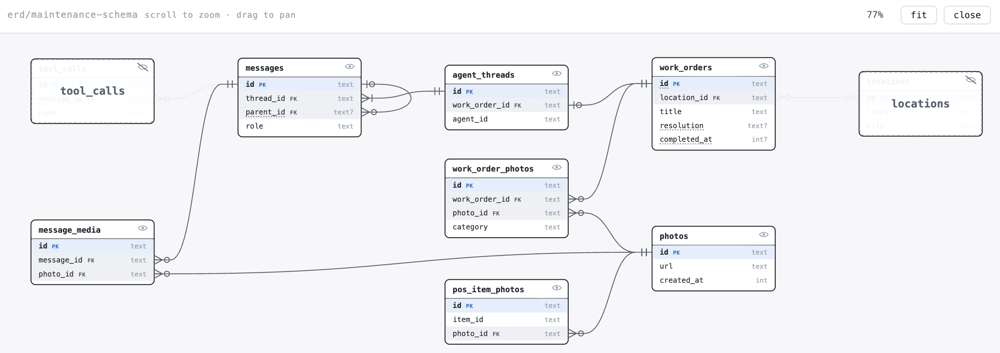
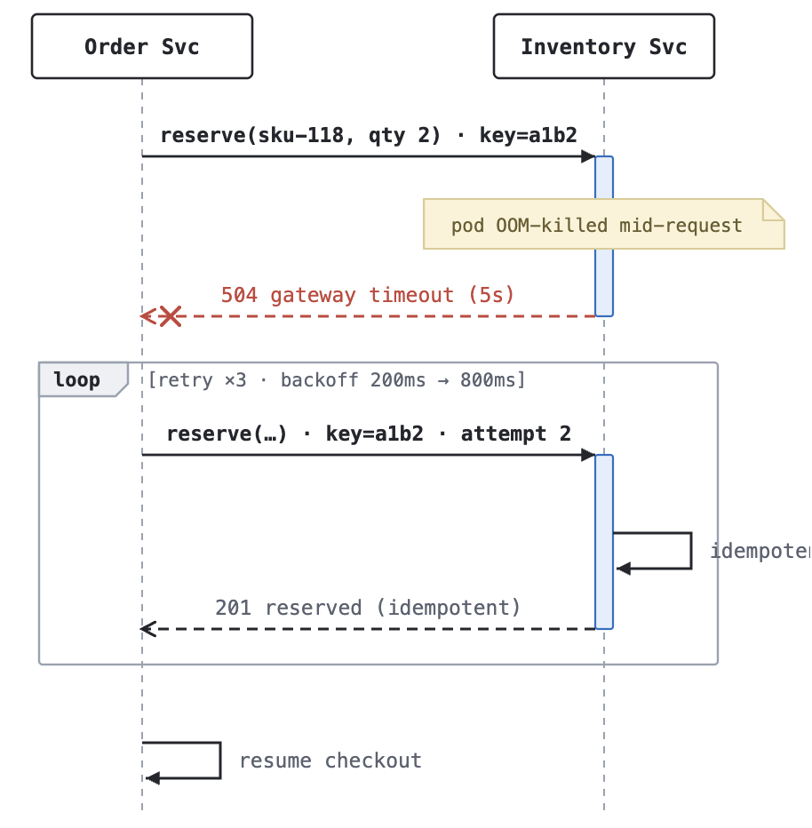
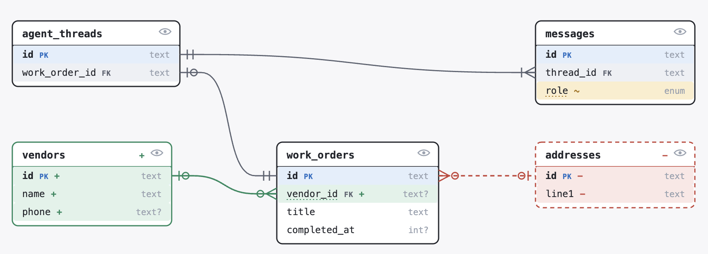
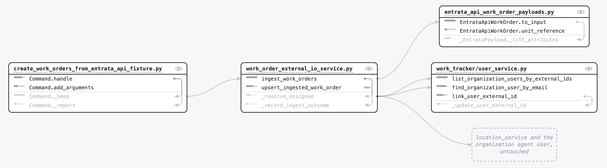
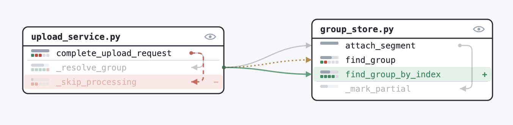
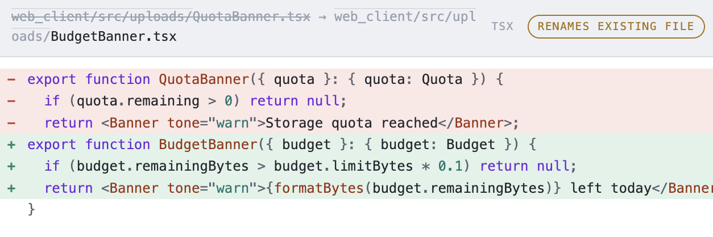
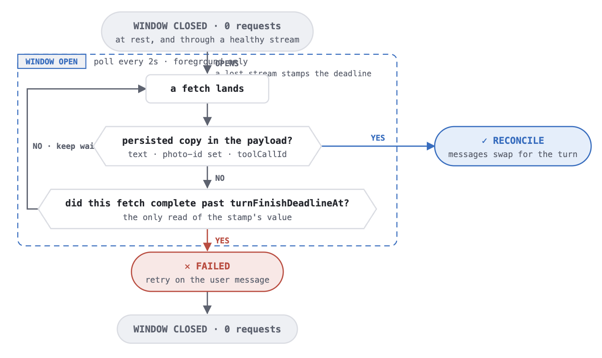

# engdoc

A toolkit to make it **easy** to build **precise** and **concise** shared understanding with other **people**, **early** in the building process.

If you have ever tried to explain to someone else a change that you spent a while iterating on, you know that this is not always straightforward. This is especially the case if the change is already in the code review phase with differing context between parties, which tends to happen much more frequently in the AI era.

## Usage

`just serve`

Then ask your agent to author a doc explaining a change or architecture using the repo and publish it under `docs/`, which produces a Markdown file.

Navigate to `localhost:4747` and look at the rendered doc.

## Structure

**Substrate:**
  - The inputs are Markdown docs with DSLs defined in codeblocks for special components, intended for agents to write.
  - Webpages rendering the Markdown, hosted locally.
  - Still developing the workflows (i.e. skills) in AGENTS.md.

**Low-level components:**
| Type | Example |
| --- | --- |
| Tabular data |  |
| Walkthroughs: light up any combination of elements in sequence |  |
| Canvases: fullscreenable, with connectable, draggable, hideable boxes |  |

**Higher-level components:**
| Type | Example |
| --- | --- |
| Sequence diagrams |  |
| Entity Relationship Diagrams: with diff rendering |  |
| Architecture and call graphs: showing dependencies between components, with diff rendering |        |
| Code diff tours |  |
| Flowcharts |  |

## Inspirations

- *The Dream Machine: J.C.R. Licklider and the Revolution That Made Computing Personal* by M. Mitchell Waldrop, 2001.
- https://github.com/cathrynlavery/diagram-design